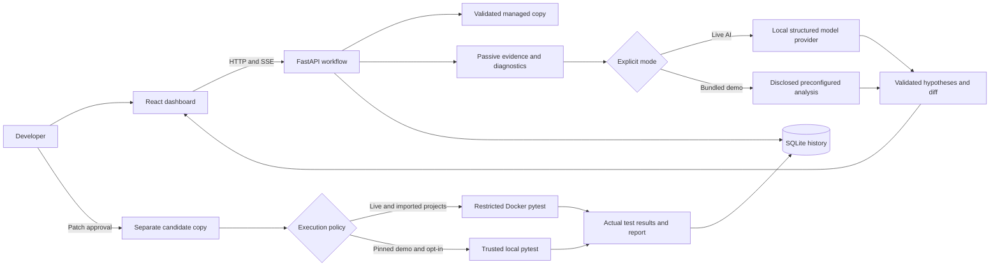

# Architecture

RootCause AI is a local, single-user investigation service. React provides the
review UI; FastAPI owns orchestration, intake, policy checks, and execution.
SQLAlchemy/SQLite preserves projects, evidence, decisions, events, and results.
The user explicitly selects Demo Mode or Live AI for each investigation.

## Explicit analysis modes

Live AI calls the configured local Ollama provider. Evidence, diagnostics, and
baseline output are sanitized before serialization. Structured responses are
validated, evidence citations are checked, and malformed schema output receives
one bounded corrective retry. Missing models, timeouts, and malformed responses
remain failures; they do not select Demo Mode automatically. Codex and Claude
Code are not runtime dependencies. Remote Ollama endpoints and cloud-tagged
model names are rejected.

Demo Mode uses `DemoProvider` for three shipped scenarios: API configuration,
SQLite query, and order-total logic. The diagnoses, alternatives, preset
confidence values, and exact repairs are predefined teaching material. The UI,
events, records, and reports disclose **Demo Investigation — Preconfigured AI
Analysis**. This provider makes no model calls. It checks collected source/config
evidence against the trusted fixture before producing its predefined output.
Evidence collection, passive diagnostics, logs, test execution, approval, and
verification still use the real application workflow.

## Workflow and verification

Every investigation copies the unchanged imported source into its own baseline.
It collects bounded source/configuration/log records, locations and timestamps,
runs baseline tests, requests hypotheses, and executes allowlisted diagnostics.
The model cannot request arbitrary commands. Passive tools are literal `search`,
AST-only `python_syntax`, and JSON/TOML `config_keys`.

Hypotheses are ranked by cited evidence: traceback/test output weight 3,
diagnostics 2, other records 1; contradiction subtracts twice its weight. Provider
confidence breaks ties and remains separate from measured facts. Unknown,
duplicate, or conflicting citation IDs are rejected. Valid citations establish
provenance, not causal truth.

The backend validates bounded exact-text edits and generates the displayed
unified diff. Approval creates a separate candidate and applies only that
reviewed patch. Base-file hashes detect stale source. Tests, configured pytest
filename patterns/test paths, dependency/setup files, hidden files, and secrets
are protected. Python/JSON/TOML candidate syntax is checked passively. Supported
CRLF and UTF-8 BOM edits preserve source formatting; mixed newlines require
exact matches.

Post-patch tests must use the same runner as the baseline. Verified status
requires an observed failing baseline, an exit-zero candidate, the same unique
test IDs, at least one fixed failure, every candidate test passing, and no
missing/regressed tests. Empty, skipped, unavailable, timed-out, or mismatched
suites cannot verify a fix. Passing project tests is bounded debugging evidence,
not proof against adversarial assertions or all possible inputs.

SSE exposes persistent observations and phase transitions. The sequence is
`queued -> collecting -> baseline -> analyzing -> diagnosing -> proposing ->
awaiting_approval`, then approval continues through `applying -> verifying`.
Reports preserve the provider/mode and execution disclosures beside actual
before/after results. Rejection leaves source unchanged. Reset Demo creates a
new project/investigation from the original scenario, preserving old history and
candidates. Selecting a demo after a blocked Live AI run also creates a separate
record.

## Execution boundaries

Imported projects and Live AI patches execute **only in Docker**. The trusted
image is built before test execution and never runs project installation hooks.
It uses a non-root user, disabled network/IPC, a read-only root and project bind,
dropped capabilities, no-new-privileges, CPU/memory/process limits, bounded
temporary filesystems, output bounds, and a timeout. A read-only snapshot at
`/project` is copied into temporary `/work/project` for scratch writes. No Docker
socket or host secret is mounted. Cleanup removes owned containers on success,
error, timeout, or cancellation.

The optional `TrustedDemoRunner` is a narrow, explicit host-execution exception:

- It is disabled by default; the user enables
  `RC_ENABLE_TRUSTED_DEMO_RUNNER` or `-EnableTrustedDemoRunner`.
- Only an explicitly selected bundled Demo Mode investigation is eligible.
  Available Docker is preferred; Live AI/imported projects never fall back.
- Literal implementation-time SHA-256 manifests pin every baseline file and
  exact deterministic candidate. Complete file/directory sets and link/reparse
  checks reject additions, omissions, changed tests, and arbitrary model edits.
- Definition bytes are checked against these embedded hashes. After validating
  a caller snapshot, the runner copies the trusted definition bytes into a fresh
  temporary directory instead of rereading caller-controlled bytes.
- A fixed argv launches Python `-I -B` and pytest with a trusted configuration,
  plugin autoload disabled, bounded output, and a minimal environment. There is
  no shell or caller-provided command.
- Windows kill-on-close jobs limit processes/memory and terminate descendants;
  timeout/cancellation cleanup operates only on owned child processes. The
  application uses at most 30 seconds for a trusted demo run.

This exception uses the host interpreter. It provides **no Docker filesystem or
network isolation**, and results explicitly identify `trusted_local_demo` with
an isolation note. Only the shipped fixture code has been authorized for this
execution path. The baseline's runner is pinned for verification; infrastructure
changes never silently change execution boundaries between runs.

## Other trust boundaries

| Input | Policy |
| --- | --- |
| Local project path | Configured import roots; no symbolic links or Windows junctions |
| ZIP | Portable relative paths; no traversal, drives, ADS, case-colliding names, links, encryption, or oversized expansion |
| Project files | Supported UTF-8 text; 2,000 files, 2 MiB/file, 32 MiB total; secret/generated/hidden content excluded |
| Source inspection | Text reads and AST parsing; no imported module execution on the host |
| AI context | Bounded recursive redaction before JSON escaping; common credentials/private keys masked |
| AI output | Strict schemas, supplied evidence IDs and allowed edit objects only |
| HTTP | Loopback binding, trusted hosts/local origins, cross-site mutation checks, streamed body cap |

Redaction is heuristic; evidence and stored test output may still contain
business data. Directory timestamps are metadata and do not prove incident
chronology. Keep imported files and dependencies under review.

## Persistence and limits

`RC_DATA_DIR` contains `rootcause.db`, `projects/<id>/source`, investigation
baselines at `investigations/<id>/source`, and approved candidates at
`investigations/<id>/candidate`. SQLite uses an additive migration for new
mode/scenario/runner metadata, preserving existing records as Live AI history.
Never delete the database to switch modes or reset a demo.

Use one backend process and keep its data directory private. At most two
investigation/verification jobs execute concurrently; starts are rejected when
eight tasks are active. Restarts mark active work `interrupted`; pending
approval remains persisted. Candidates are not promoted automatically.

The Docker image supports dependencies installed at image-build time. Arbitrary
dependency installation, public hosting, remote-user authorization, distributed
queues, and infrastructure repair are outside this application. Docker is a
practical development boundary, not a hardened multi-tenant service; hostile
Python can manipulate its own assertions/reports inside its execution process.
The preconfigured demo and its local execution do not validate live model
quality or the unavailable Docker runtime.

See [API semantics](api.md), [operator steps](demo.md), and
[executed verification](verification.md) for observed checks and limitations.
