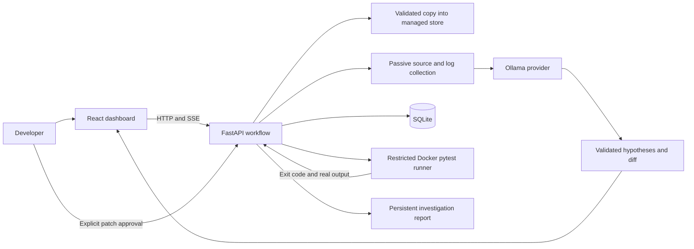

# Architecture

RootCause AI is a single-user, local investigation service. React provides the
review UI; FastAPI owns the workflow and all security checks. SQLAlchemy/SQLite
persists the investigation record. Ollama produces structured, evidence-grounded
hypotheses and proposed edits. Docker is the only execution path for imported
project code.

## Workflow

Every investigation creates an unchanged source copy from the imported project.
It first collects bounded source, configuration, and submitted
error evidence. A baseline Docker pytest run records the observed failure state.
The provider receives sanitized evidence, stable evidence IDs, and source
locations. Its output is untrusted data, parsed against a schema. The backend
retains the distinction between observed facts and AI-generated hypotheses.

Diagnostics are selected from server-owned operations. The provider cannot
introduce a shell command or choose arbitrary host paths. Relevant diagnostic
results and test output become further observed evidence. Rankings are grounded
in supporting and contradicting citations, and uncertainty remains visible.

A proposed patch is represented as bounded exact-text edits to existing allowed
files. The backend produces a unified diff for review. The application waits for
an explicit approve/reject decision before writing the approved edits. Approval
creates a separate candidate copy within the investigation; it does not modify
the imported project or the investigation's baseline source. A hash of every
reviewed base file detects stale workspaces.

After approval, a real post-patch Docker pytest run records its own result.
The `verified` outcome requires an observed failing baseline, an exit-zero
post-patch run, an identical set of unique test IDs, at least one failure changed
to pass, no regressed or missing test, and every post-patch test passing.
Completion depends on verification output. Passing tests, remaining failures,
regressions, timeouts, provider failures, and unavailable infrastructure are
different outcomes. A report includes both baseline and post-patch evidence,
diagnoses, review decisions, and test results. Server-Sent Events expose actual
workflow activity and persisted events to the dashboard. These events describe
phase transitions and observations; they are not model token streaming.

The main phase sequence is `queued → collecting → baseline → analyzing →
diagnosing → proposing → awaiting_approval`. Approval continues through
`applying → verifying`, then an observed outcome. Other outcomes are `rejected`,
`blocked`, `insufficient_evidence`, `interrupted`, `failed`, and `regression`.
An already passing baseline yields `insufficient_evidence`; there is no basis to
claim a repair. An unavailable Docker baseline is recorded honestly; analysis
may continue on static evidence, but verification remains impossible until a
real failing baseline and post-patch run are available.

Hypotheses are sorted using a deterministic citation score: traceback and test
output records carry weight 3, diagnostic records 2, and other records 1.
Contradicting evidence subtracts twice its weight. Model confidence breaks score
ties and is presented separately; it is not a measured probability. Duplicate,
unknown, or mutually supporting/contradicting citation IDs are rejected. Citation
validation establishes provenance, not that a model's causal reasoning is true.

Diagnostics are passive `search` (bounded literal text matching), `python_syntax`
(AST parsing), and `config_keys` (JSON/TOML top-level keys). Up to 12 distinct
model-requested checks run; requested observations can trigger one reassessment
before patch generation. There are no provider-authored shell commands.

## Trust boundaries

| Input or component | Boundary |
| --- | --- |
| Local directory path | Must resolve inside configured import roots; links and Windows junctions are rejected |
| ZIP archive | Portable relative paths only; no traversal, drives, ADS, duplicate case-insensitive paths, links, encryption, or oversized expansion |
| Project contents | UTF-8 text allowlist, bounded file count/bytes, generated and common secret files excluded |
| Source inspection | Text reads and syntax-tree parsing only; never import or execute an imported module on the host |
| AI context | Bounded, sanitized evidence; common key, token, password, URL-credential and private-key patterns redacted |
| AI result | Structured hypotheses and allowed edit objects; invalid or ungrounded output is rejected or reported |
| Diagnostics | Backend allowlist; no AI-generated shell or arbitrary command execution |
| Patch | Existing application source/configuration only, exact matches, syntax checks, immutable tests and setup configuration, unchanged base hashes |
| Test execution | Non-root Docker container, read-only mounts/filesystem, network disabled, bounded resources and runtime |
| Browser | Local frontend/backend origins; do not expose this service publicly |

Intake limits are 2,000 included files, 2 MiB per file, and 32 MiB total.
Evidence collection further bounds record count, per-record content, and total
context. File locations and observation times are retained. File timestamps are
metadata; they do not establish the chronology of a production incident.

The runner image is built separately from imported projects. It contains Python
and pytest and does not execute imported installation hooks. Project source is
mounted read-only at `/project` and copied to temporary `/work/project` before
pytest starts. Writable scratch storage is confined to `/work` and `/tmp`. Neither
the Docker socket nor host secrets are mounted into the container. The backend
has Docker access on the host to start and clean up runners, so it is itself a
trusted local process.

## Provider and persistence

The AI provider is configured by `RC_OLLAMA_URL` and `RC_OLLAMA_MODEL`. Only
loopback HTTP URLs without credentials are accepted, and cloud-tagged model
names are rejected. An empty
model name asks the provider to inspect Ollama's installed models and select
Gemma. A configured local non-cloud model name can override auto-selection.
Another assistant's model configuration is not an Ollama connection. An
unreachable endpoint, absent model, timeout, or malformed model response is a
reported failure; none is replaced with a prewritten demo diagnosis. Structured
output gets one corrective retry for malformed schema output. AI request timeouts
apply per request, not to the entire multi-phase investigation.

The managed data directory contains `rootcause.db`, imported copies under
`projects/<id>/source`, investigation baselines under
`investigations/<id>/source`, and approved candidates under
`investigations/<id>/candidate`.
Do not point it at a public, shared, or untrusted writable location. Source
evidence and test output can include business data despite credential redaction.
Treat the entire data directory as sensitive. The application is designed for a
single backend process with a local event stream, not distributed job execution.
At most two investigation/verification jobs execute concurrently; the start
endpoint rejects new investigations once eight tasks are active.
Each new investigation starts from the original imported copy; candidates are
not automatically promoted. A restart marks nonterminal work `interrupted`;
pending approval proposals remain persisted and reviewable.

## Deliberate limits

- The shipped image supports Python/pytest projects with dependencies already in
  the image. Arbitrary project dependency installation is unsupported at runtime.
- The agent uses a controlled state machine. It cannot browse the internet,
  execute model-authored commands, or repair arbitrary infrastructure.
- Patch protection prevents test edits; the existing suite remains the
  verification oracle. Passing that suite is bounded evidence, not a proof.
- Project code and its tests share a Python interpreter, so hostile application
  code can tamper with its own assertions or test reports. Recorded pytest outcomes
  support debugging; they do not attest correctness of adversarial programs.
- Text redaction is heuristic. Inference is restricted to local Ollama; do not
  import secrets deliberately.
- Docker on a local development machine is a practical execution boundary, not a
  hardened multi-tenant sandbox. Keep imported projects and dependencies under
  review and keep Docker/its host VM updated.
- There is no account system, remote-user authorization, public deployment, or
  durable distributed job queue. Services bind to `127.0.0.1`.

See [demo.md](demo.md) for reproducible operator steps and failure handling and
[api.md](api.md) for routes, events, and response semantics.
